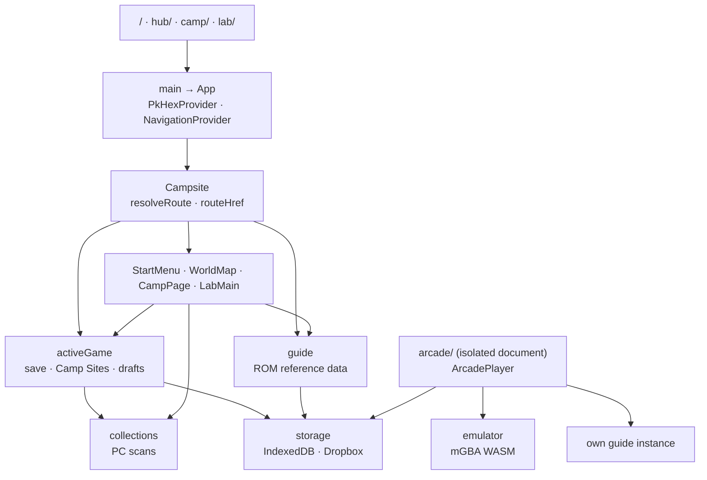

# pkCamp architecture

pkCamp is a static, browser-only React/Vite site served under `/pkcamp/`. Start,
Hub, Camp, and Lab are separate static entries (`index.html`, `hub/`, `camp/`,
`lab/`) that load the same app: `main.tsx` initializes i18n, and `App` mounts
`PkHexProvider` and `NavigationProvider` around `Campsite`. `Campsite` resolves
the validated URL (`routing.ts`: page, `?game=`, `mode=`, `tab=`), sends invalid
routes to Start, and renders `StartMenu`, `WorldMap`, `CampPage`, or `LabMain`.
Internal moves use the History API and shared leave guards. When a Lab entry
opens a Cabin box or Camp Site, Lab stays mounted (hidden) so Back returns to
the same entry.

The selected game drives the shared services. Route glue hands `?game=` and the
storage provider to `activeGame`, which loads the save and Camp Sites once and
owns every draft and commit; `collections` rescans when it publishes a change,
and `guide` extracts reference data from the game's ROM. Arcade is a separate
cross-origin-isolated document (`arcade/`, `playerMain.tsx` → `ArcadePlayer`),
so it starts its own storage and `guide` instances and syncs in-game saves back
through storage. Directory architecture files describe each part:
[pages/context](src/pages/context/ARCHITECTURE.md),
[hub](src/pages/hub/ARCHITECTURE.md),
[Camp](src/pages/pokestorage/ARCHITECTURE.md),
[Lab](src/pages/pokestorage/lab/ARCHITECTURE.md),
[Arcade](src/pages/pokestorage/arcade/ARCHITECTURE.md),
[services](src/services/ARCHITECTURE.md), and [build and checks](docs/BUILD.md).

