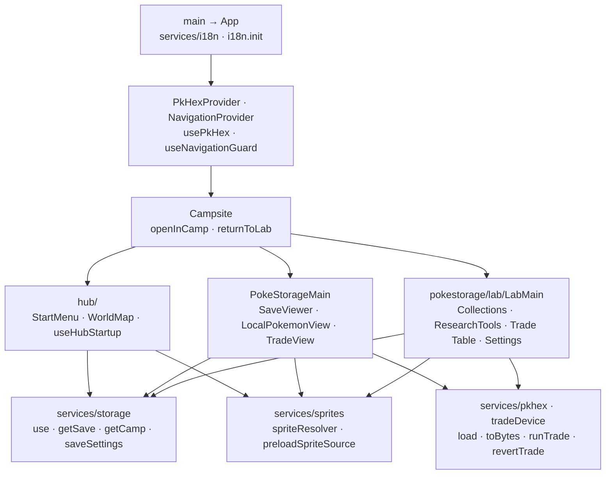

# pkCamp architecture

pkCamp is a browser-only React/Vite app. `main.tsx` initializes the shared i18n service; `App` supplies PKHeX and navigation providers. `Campsite` switches
between Start, the zone-card menu, Camp, and Lab using component state.
The menu opens Camp/Lab and shows Arcade as coming soon; Battle, Safari, and
Pelago cards are hidden. Lab remains mounted when
visiting a source Cabin/Camp Site so Back restores its research context.
Navigation guards protect unsaved work and active tasks; shared provider reads
keep editor bytes separate and publish saved sprite preferences site-wide.

The current folders still place Lab and shared React hooks/UI under
`pages/pokestorage/`; services handle parsing, persistence, sprites, and devices.
[Build structure](docs/ARCHITECTURE.md) and directory architecture files cover
those implementations.

