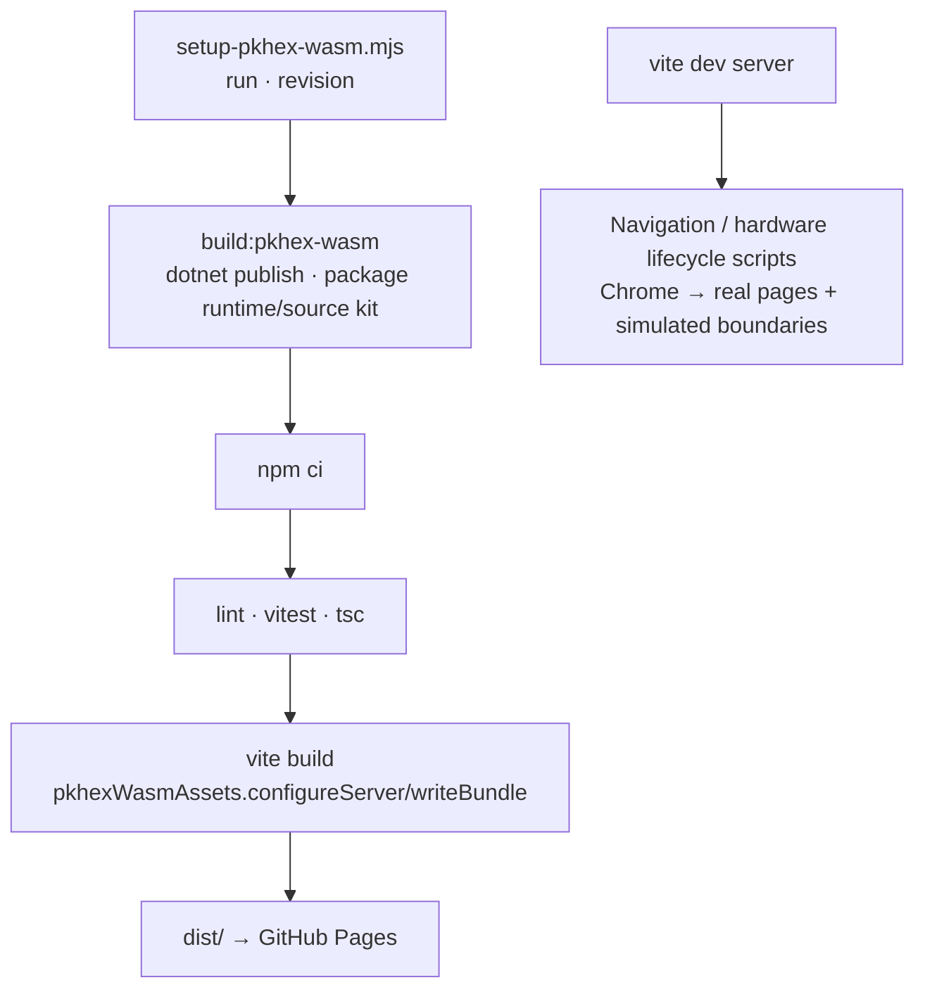

# Build and verification architecture

The [application overview](../ARCHITECTURE.md) describes runtime pages and
services. The build prepares the ignored local `pkhex-wasm` package before root
installation: `setup-pkhex-wasm.mjs` fetches pinned source revisions, refuses to
reset a mismatched checkout, and invokes packaging. Vite serves/copies its WASM
runtime beneath the `/pkcamp/` base path. The production trade placeholder is
tracked in `src/assets/trade/`; personal save fixtures remain ignored.

The deployment workflow configures Node 24, .NET 10, and `wasm-tools`, then runs
setup, install, strict maintained-code lint, tests, and build before Pages
upload/deploy. Vendored code is excluded from lint; real-save tests skip without
local fixtures. `verify-navigation.mjs` uses Chrome against a running dev server
(default port 5174, overridable with `PKCAMP_TEST_URL`), checking a mock harness
and actual Start/Lab/settings navigation without live accounts or hardware.
`verify-hardware-lifecycle.mjs` adds a simulated device/session harness against
the real tool pages (default port 5173, same URL override).

