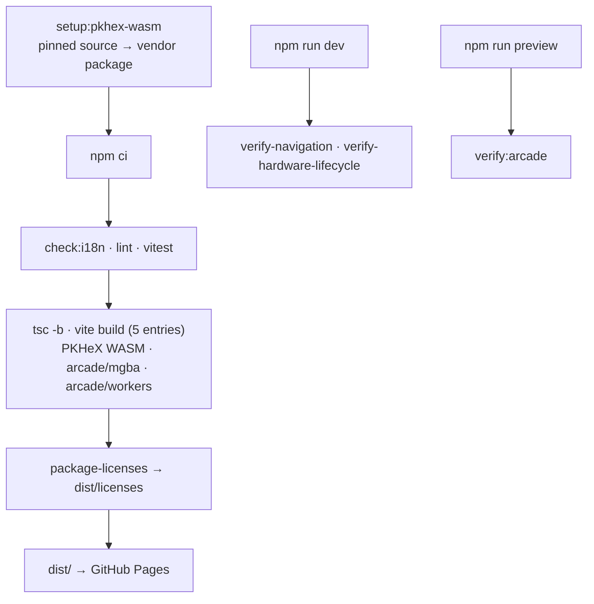

# Build, deploy, and checks

How the static site is built, deployed to GitHub Pages, and verified. The
[application overview](../ARCHITECTURE.md) covers runtime pages and services.

`npm run setup:pkhex-wasm` (`scripts/setup-pkhex-wasm.mjs`) fetches the pinned
`vendor/pkhex-wasm` source, refuses to reset a mismatched checkout, and packages
the ignored local `pkhex-wasm` dependency before `npm ci`. `npm run build` runs
`tsc -b`, then `vite build` with five HTML entries (Start, `hub/`, `camp/`,
`lab/`, `arcade/`) under the `/pkcamp/` base, then `package-licenses.mjs`, which
checks the .NET runtime notices and publishes license files to `dist/licenses/`.
Vite plugins serve and copy the PKHeX WASM runtime and the unchanged mGBA loader
into `arcade/mgba/`; guide workers are emitted under `arcade/workers/` so the
Arcade isolation service worker controls them. The `deploy.yml` workflow (Node
24, .NET 10, `wasm-tools`) runs setup, install, `check:i18n`, lint, tests, and
build, then deploys `dist/` to Pages.

Vitest covers `src/` only; real-save and real-ROM tests skip without local
fixtures, which are never committed. Browser checks use Playwright with Chrome:
`verify-navigation.mjs` (navigation and guards) and
`verify-hardware-lifecycle.mjs` (simulated devices on the real tool pages) run
against the dev server; `npm run verify:arcade` (bootstrap/isolation, Start
cartridge selection, player layout) runs against `npm run preview`. See
[Arcade runtime evidence](ARCADE_RUNTIME.md) for its options.

