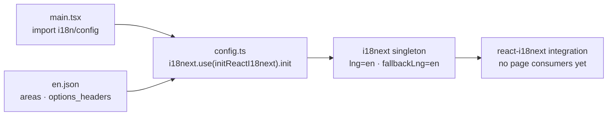

# i18n architecture

`main.tsx` imports `config.ts` once. It initializes `i18next` through
`initReactI18next`, registers `en.json` in the translation namespace, selects
English for both language and fallback, and disables interpolation escaping
because React handles text escaping.

This is retained scaffolding: screens currently use inline text and do not
call `useTranslation()`. The small English catalog contains early area names
and a news heading; runtime language switching/detection is absent. The current
location is `src/i18n/`; relocation and translation work are tracked in the
[site roadmap](../../ROADMAP.md), not implemented here.

