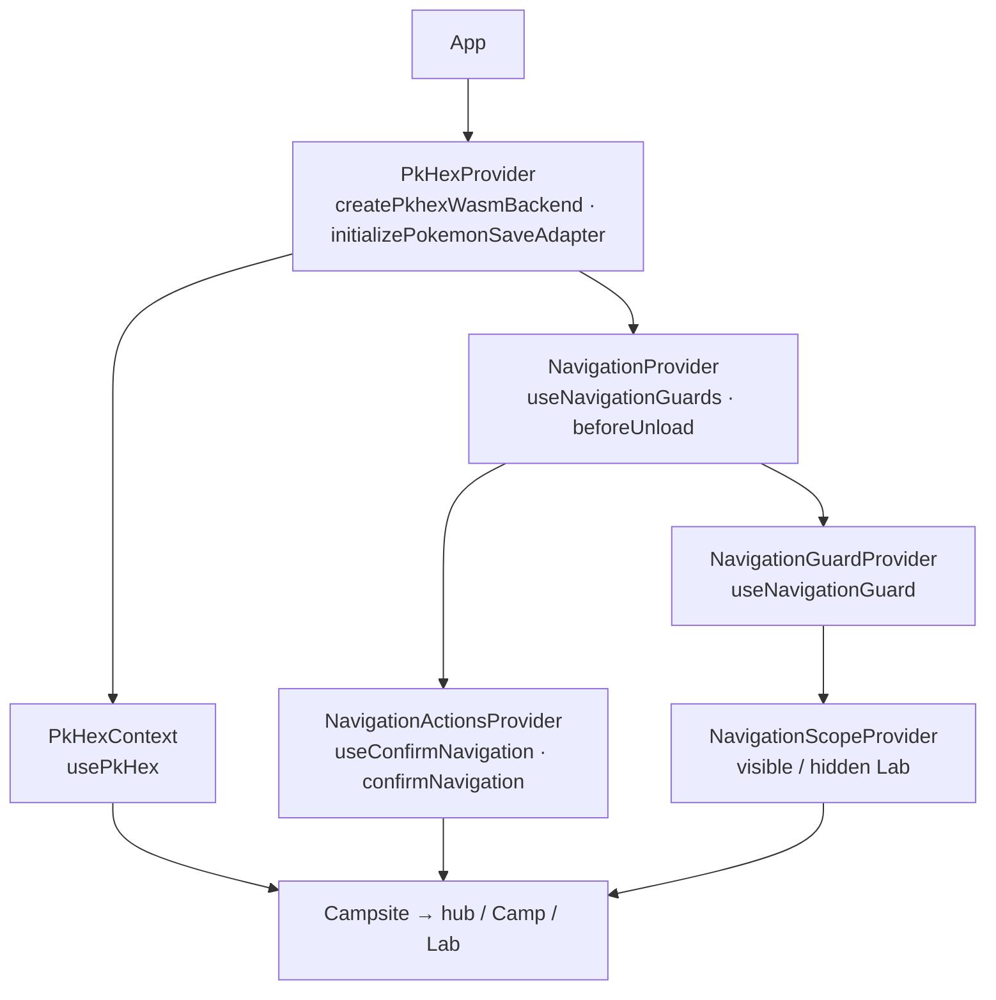

# Application providers

`App` mounts `PkHexProvider` around `NavigationProvider` and then `Campsite`.
PKHeX initializes one WASM backend and publishes its adapter/loading/error
state. Screens and scans own and dispose their parsed `SaveGame` objects;
storage request sharing never shares a mutable WASM editor.

Navigation has one application registry. Screen hooks register dirty state or
active tasks, Back/Dropbox/replacement actions consult it, and one
`beforeunload` listener warns on browser exit. `NavigationScopeProvider`
suspends guards in preserved hidden Lab screens. Acceptance permits leaving;
it does not roll back persisted or physical-device writes.

