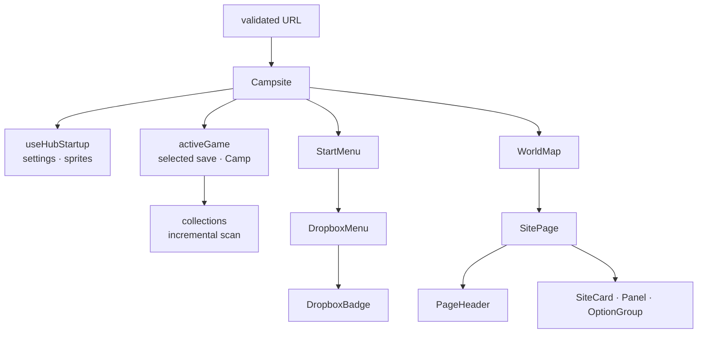

# Hub architecture

`Campsite` resolves the validated URL and renders Start, Hub, Camp, or Lab. The
History API navigation provider owns internal route changes and shared leave
guards. Arcade remains a separate document.

`useHubStartup` waits for the active storage provider and settings, then
preloads only the selected sprite source. Route glue hydrates `activeGame` with
the URL's game and current provider. It clears the selection and returns to
Start when the provider/account changes.

The shared `collections` service listens to committed `activeGame` changes. It
scans the selected committed save and Camp Sites, then merges those source
matches with preserved results from other games. Start does not scan every
save or prefetch the save library.

## Page frame and shared components

Every page except Start is `SitePage`: one board that fills the viewport, the
shared `PageHeader` (Back, the game, a diagonal divider into the page name and
the GitHub and Dropbox badges), and a body that takes the remaining height. The
page never scrolls as a whole; long content scrolls inside a `Panel`.

| Component     | Role                                                                          |
| ------------- | ----------------------------------------------------------------------------- |
| `SitePage`    | Frame and header; supplies the Dropbox badge's Lab Settings → storage link.   |
| `PageHeader`  | The header alone. Takes `onOpenSettings`, so the isolated Arcade can use it.  |
| `SiteCard`    | A large pressable tile (Hub, Lab menu, Research Tools).                       |
| `Panel`       | A bordered surface that scrolls its own content.                              |
| `OptionGroup` | One-of-many buttons: a toggle (`row`), a settings list (`rail`), or a `grid`. |
| `Dialog`      | A modal `<dialog>` controlled by `open`.                                      |

Styles live in `siteComponents.css` (cards, panels, options), `pageHeader.css`
and `hub.css` (frame, Start, Hub). The Hub and Lab menus position their cards
with one `grid-template-areas`; the other pages use flex ratios.

## Lab and Camp

`LabMain` is route-driven: `/lab/?mode=` picks the page, and it stays mounted
(hidden) while Camp is open from a PC entry. The PC reads and writes everything
(tabs, filter, selected entry, match) through the `collections` service.

`CampPage` works on the `activeGame` working copy. Moves, group moves and
Camp Site swaps are draft edits until Save; leaving with a draft asks first and
then discards it. Trade mode reuses `useTradeSession`, which still writes
storage directly, so `CampPage` reloads `activeGame` after a trade.
