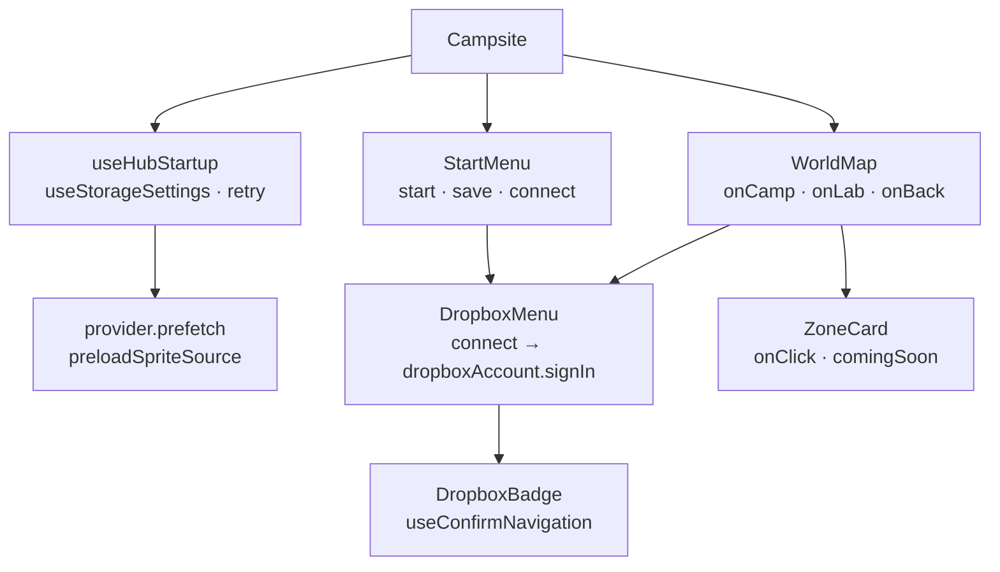

# Hub architecture

`Campsite` renders either `StartMenu` or `WorldMap`. Start has one entry button,
a configured Dropbox badge, project credits, and first-run source selection
with optional sign-in. WorldMap enables Camp/Lab, shows Arcade as coming soon,
hides Battle/Safari/Pelago, and places a subdued Start-menu link beneath its cards. Both pages use
`DropboxMenu`; their navigation is component state rather than URL routes.

`useHubStartup` stays mounted with the shell, waits for account/settings
readiness, then begins storage prefetch and shared sprite preloading without
waiting for downloads to finish. It returns provider/readiness/source/error/
retry state. Saving through the provider publishes source changes; the hub has
no separate settings cache. Shared cards, hooks, and badge still come from Camp.

