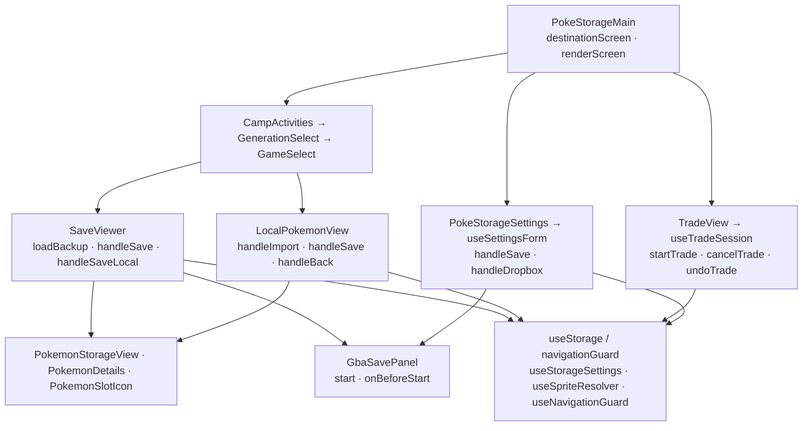

# Camp architecture

`PokeStorageMain` routes Camp activities, platform-era lodges, GBA Cabins,
Camp Sites, trades, and settings. Only Gen 3 is enabled. `SaveViewer` and
`LocalPokemonView` stage game/Camp edits independently until explicit Save;
party slots are view-only. Save loads reject mismatched games and invalidate
older requests on replacement/unmount. Cartridge backup and completed trade
actions persist as explicit operations. The Camp Office is reachable through
the configured Dropbox badge; its activity-menu shortcut is commented out.

Camp and Lab reuse settings/trade hooks and panels, with one root navigation
guard protecting edits and active tasks. `useStorageProvider` supplies wrapped
storage, `useStorageSettings` subscribes to preferences, and `useSpriteResolver`
follows saved source changes. Shared hooks/UI and Lab still live here; the old
`Splash` is unused. [PLAN.md](PLAN.md) holds product descriptions and
[ROADMAP.md](ROADMAP.md) holds task status.

