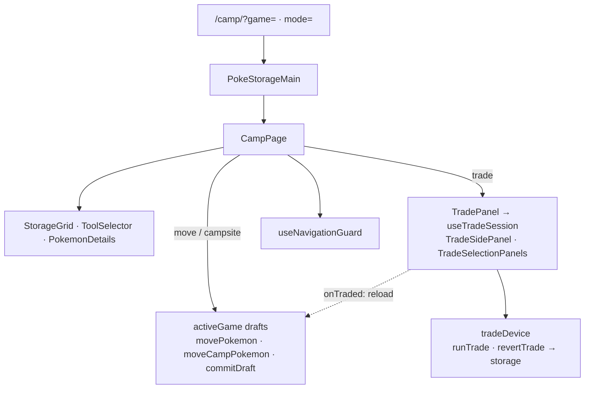

# Camp architecture

`PokeStorageMain` is the Camp route's thin wrapper around `CampPage`; it passes
the Lab destination and the Back target. `CampPage` shows the selected save (or
a Camp Site when no game is selected) on the left and, by `mode=`, a second save
grid (`move`), a Camp Site grid (`campsite`), or `TradePanel` (`trade`) on the
right. `StorageGrid` draws one box, party, or Camp Site; `ToolSelector` picks
View, Move, or Group move; `PokemonDetails` shows the selected Pokémon. Every
move, group move, and Camp Site swap is a draft in `activeGame` until Save
calls `commitDraft`; party slots are view-only, and leaving with a draft asks
first, then discards it. Trades go through `useTradeSession` and the
`tradeDevice` service, which still write storage directly, so `CampPage`
reloads `activeGame` after a trade.

This folder also holds modules shared with Hub, Lab, and Arcade until they move
to `features/`/`shared/`: storage hooks (`useStorage`: provider, settings,
sprite resolver, theme), the navigation guard registry, Settings sections and
`useSettingsForm`, GB-Link task and firmware panels, `DropboxBadge`, sprite and
game display helpers, and the species reference views in `guide/` used by
the Arcade Guide and the Lab PC. [PLAN.md](PLAN.md) holds product intent and
[ROADMAP.md](ROADMAP.md) holds task status.

