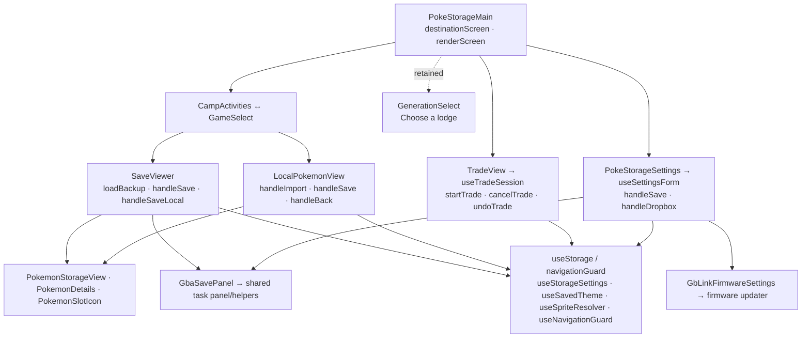

# Camp architecture

`PokeStorageMain` routes Camp activities, platform-era lodges, GBA Cabins,
Camp Sites, trades, and settings. Camp Lodges opens GBA directly, and GBA Back
returns to activities; the lodge chooser remains implemented but bypassed. Only
Gen 3 is enabled. `SaveViewer` and
`LocalPokemonView` stage game/Camp edits independently until explicit Save;
party slots are view-only. Save loads reject mismatched games and invalidate
older requests on replacement/unmount. Cartridge backup and completed trade
actions persist as explicit operations. The Camp Office is reachable through
the configured Dropbox badge.

Camp and Lab reuse settings/trade hooks, task panels, and `gbLinkTask` helpers,
with one root navigation guard protecting edits, active tasks, and hardware
settings-tab changes. Shared Settings exposes installed/latest GB-Link firmware
and the automatic updater. `useStorageProvider` supplies wrapped
storage, `useStorageSettings` subscribes to preferences, `useSavedTheme`
applies the saved color theme, and `useSpriteResolver`
follows saved source changes. Shared hooks/UI and Lab still live here;
`Campsite` renders the Camp entry directly without a wrapper. [PLAN.md](PLAN.md) holds product descriptions and
[ROADMAP.md](ROADMAP.md) holds task status.

