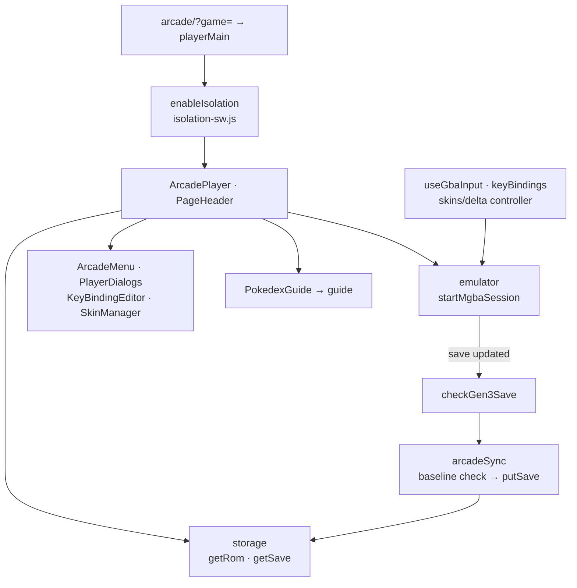

# Arcade architecture

Arcade is its own static entry (`arcade/index.html` → `playerMain.tsx`) because
the threaded mGBA runtime needs cross-origin isolation, which would block the
main app's external sprite hosts. `playerMain` validates `?game=` (anything
else returns to the Hub or Start), and `enableIsolation` registers the scoped
`arcade/isolation-sw.js` worker, reloading once if the document is not yet
isolated, before mounting `ArcadePlayer`. The player uses the shared
`PageHeader`, starts its own storage provider and `guide` instance, reads the
selected game's ROM and save, checks the ROM with `assertArcadeRomMatchesGame`,
and boots it with `startMgbaSession` from the emulator service.

When mGBA reports a save, the player waits for it to settle and keeps it only if
`checkGen3Save` finds a complete newest slot. `arcadeSync` then writes one save
at a time to the provider captured at startup, compares Camp's save with its
baseline first, and reports Saving, Saved, Retry, or conflict; exit, restart,
file replacement, and provider changes are guarded until it has nothing
unsynced. `ArcadeMenu` (Controls, Skins, Advanced file tools) and
`PlayerDialogs` pause the game; `PokedexGuide` shows `guide` data with the
`guide/` species views. Input comes from `useGbaInput` (keyboard, with
`keyBindings` in `localStorage`) and the Delta skin controller in
`skins/delta/` (see its [README](skins/delta/README.md)), merged by the
emulator's `GbaInputTracker`. `KeyBindingEditor` and `SkinManager` are shared
with Lab Settings → Arcade. Private ROMs, saves, and browser output are never
committed. [ARCADE_ZONE_PLAN.md](../../../../docs/ARCADE_ZONE_PLAN.md) holds
product intent and [ARCADE_RUNTIME.md](../../../../docs/ARCADE_RUNTIME.md)
holds verification evidence.

