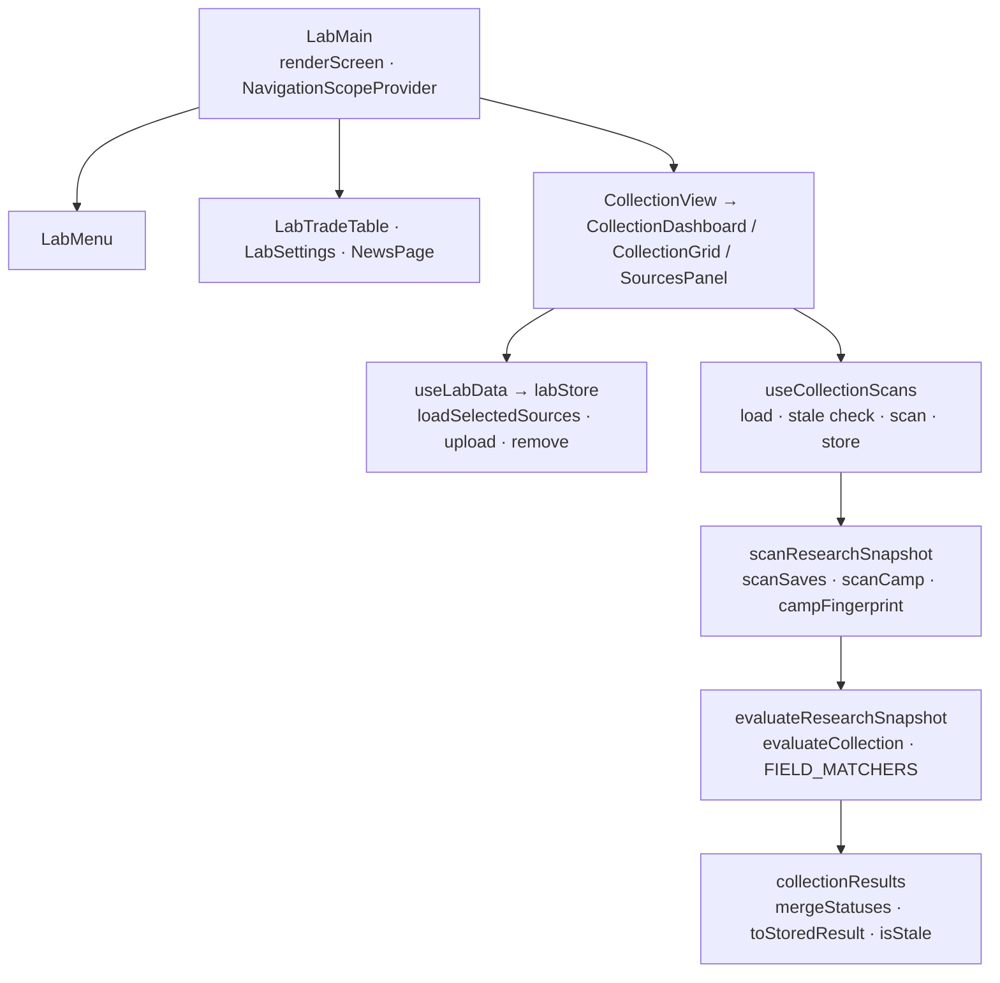

# Lab architecture

`LabMain` switches between Celio's menu, collections, Trade Table, Settings,
and Patch Notes. Trades/settings reuse Camp behavior with Lab styling.
Collection location actions open a Cabin box or Camp Site; the Lab remains
mounted for return navigation, and its guard scope is suspended while hidden.

Collections are validated JSON definitions. Selected committed Cabin saves and
Gen 3 Camp Sites form one research snapshot, evaluated against all definitions
and merged with owned/seen/unseen history. Results are rebuildable and do not
mutate source bytes. Versions, source choices, save timestamps, and Camp layout
fingerprints control stale checks. Source choices/uploads/results live in the
active provider; `useLabData` migrates legacy browser data once.

