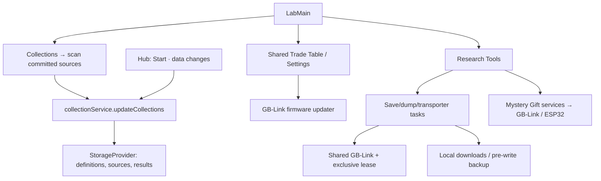

# Lab architecture

`LabMain` switches between Celio's menu, collections, Trade Table, Research
Tools, Settings, and Patch Notes. Collections evaluate validated definitions
against committed Cabin saves and Camp Sites through `collectionService`:
`updateCollections` takes any definitions and sources, marks matches owned and
previously owned entries seen (both count as registered), and stores complete
results. The hub runs it on Start and after save data changes; an open Lab
re-reads what it stores. Source choices, uploads, and rebuildable
results/history live in active storage; Settings → Data deletes them. Visiting a source location
preserves the Lab screen and suspends its navigation guards while hidden.
Trading and settings reuse Camp's shared logic and panels.

Research Tools opens saves, dumps, Mystery Gifts, and transporter workspaces.
`GbLinkTaskPanel` and `gbLinkTask` share task presentation, instructions,
errors, and cartridge metadata capture. Save/ROM/BIOS downloads stay local;
restore stores the original save as the Cabin's hardware backup. Gift services
own GBA/ESP32 sessions, and transporter services provide optional backups and
verified multiboot launch. Active work uses navigation guards, abort signals,
and exclusive device leases. Each GB-Link task, and each finished GBA gift
group, releases the device when it ends; the next one reconnects to the
permitted GB-Link without the chooser. Leaving Research Tools also releases it.

