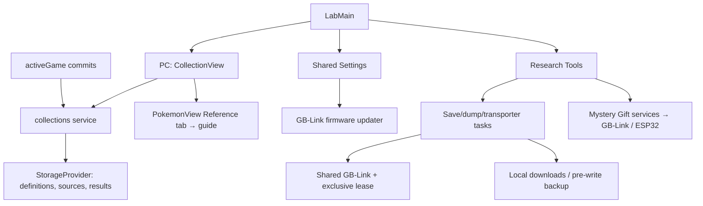

# Lab architecture

`LabMain` is route-driven (`/lab/?mode=`) and switches between Celio's menu,
the PC, Poké Transporter GB, Research Tools, Settings, and Patch Notes. The PC
(`CollectionView`) reads and writes its tabs, filters, selected entry, and match
through the shared `collections` service, which rescans the selected committed
save plus Camp Sites whenever `activeGame` commits a change. The entry screen
(`PokemonView`) adds a Reference tab with `guide` data. Source choices, uploads, and rebuildable
results/history live in active storage; Settings → Data deletes them. Visiting a
source location keeps the Lab mounted (hidden) with its navigation guards
suspended, so Back returns to the same entry. Settings reuses Camp's shared
sections; trading lives only in Camp.

Research Tools opens saves, dumps, Mystery Gifts, and transporter workspaces.
`GbLinkTaskPanel` and `gbLinkTask` share task presentation, instructions,
errors, and cartridge metadata capture. Save/ROM/BIOS downloads stay local;
restore stores the original save as the Cabin's hardware backup. Gift services
own GBA/ESP32 sessions, and transporter services provide optional backups and
verified multiboot launch. Active work uses navigation guards, abort signals,
and exclusive device leases. Each GB-Link task, and each finished GBA gift
group, releases the device when it ends; the next one reconnects to the
permitted GB-Link without the chooser. Leaving Research Tools also releases it.

