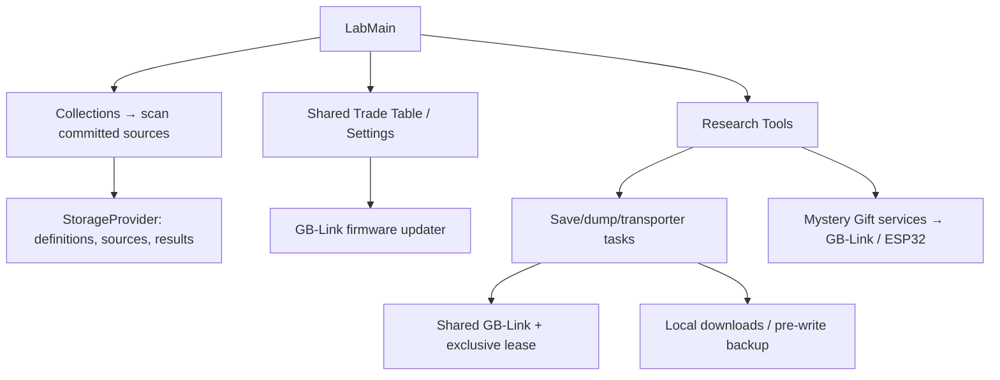

# Lab architecture

`LabMain` switches between Celio's menu, collections, Trade Table, Research
Tools, Settings, and Patch Notes. Collections evaluate validated definitions
against committed Cabin saves and Camp Sites; source choices, uploads, and
rebuildable results/history live in active storage. Visiting a source location
preserves the Lab screen and suspends its navigation guards while hidden.
Trading and settings reuse Camp's shared logic and panels.

Research Tools opens saves, dumps, Mystery Gifts, and transporter workspaces.
`GbLinkTaskPanel` and `gbLinkTask` share task presentation, instructions,
errors, and cartridge metadata capture. Save/ROM/BIOS downloads stay local;
restore stores the original save as the Cabin's hardware backup. Gift services
own GBA/ESP32 sessions, and transporter services provide optional backups and
verified multiboot launch. Active work uses navigation guards, abort signals,
and exclusive device leases; the Lab releases GB-Link on leaving Research Tools.

