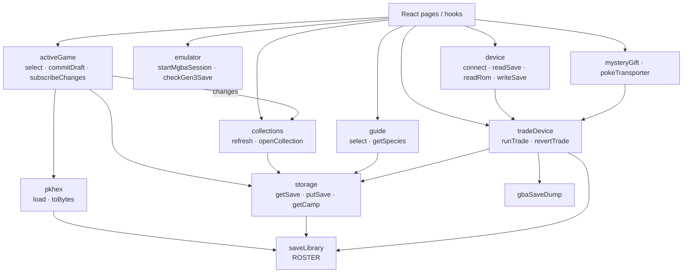

# Services architecture

Services own framework-free data boundaries and never import page modules. The
roster (`saveLibrary`) names games, `pkhex` parses/writes Pokémon data,
`storage` persists opaque bytes in IndexedDB or Dropbox, `sprites` resolve and
preload artwork, `i18n` and `themes` set up translations and color tokens, and
the device services (`tradeDevice`, `gbaSaveDump`, `mysteryGift`,
`pokeTransporter`) handle trades, cartridge transfers, Mystery Gift sessions,
transporter multiboot, and firmware updates. `device` is the page-facing
GB-Link facade, so screens never choose a transport themselves.

Four services hold shared app state as singletons that React reads through
`useSyncExternalStore` hooks in `pages/context/`. `activeGame` owns the selected
save, Camp Sites, drafts, and commits, and announces committed changes.
`collections` listens to those changes and rescans only the affected sources for
the Lab PC. `guide` extracts and caches the selected ROM's reference data in a
worker. `emulator` wraps the mGBA WASM runtime, GBA ROM identity, Gen 3 save
completeness checks, and input merging for the Arcade player. Each directory's
ARCHITECTURE.md covers its own design.

