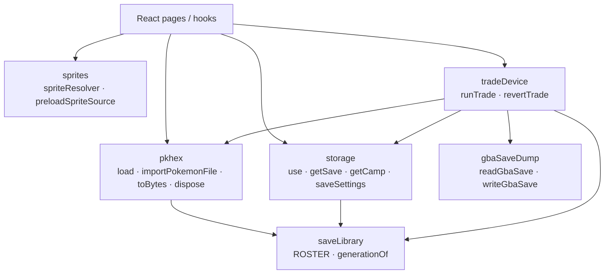

# Services architecture

Services own framework-free data boundaries: the roster names games, PKHeX
parses/writes Pokémon data, storage persists opaque bytes, sprites resolve and
preload presentation assets, and device services handle trades/cartridge
transfers. React consumes typed APIs rather than WASM objects or raw transport
protocols. Services do not import page modules.

Active storage wraps providers to share pending reads and observable settings
without sharing mutable editors. Sprite resolution stays pure; a separate
resource module caches resolvers and optionally loads browser images. React
subscription hooks and navigation guards remain in the page layer. There is no
emulator service or `services/i18n/` directory in the current implementation.

