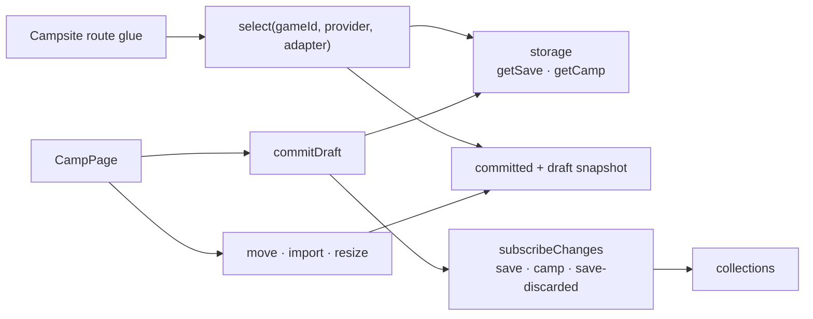

# Active game service

`activeGame` (an `ActiveGameService`) owns the selected game's save and the Gen 3
Camp Sites for one app lifetime. Route glue calls `select(gameId, provider,
adapter)`; repeated calls share the pending load, and a different game or
provider discards stale results. With no game it still loads the Camp Sites.
Pages read the in-memory copy through `getSnapshot`/`subscribe` (`useActiveGame`)
instead of fetching from storage.

Edits (`movePokemon`, `moveCampPokemon`, `moveSavePokemonToCamp`, group moves,
imports, Camp resizing) change a working copy and mark the snapshot dirty.
`commitDraft` writes the save and Camp separately and reports partial commits;
failed work stays in the draft. Replacing, restoring, or discarding a save, and
reading other games' saves (`readSecondarySave`), also go through the service.
Each committed change is published to `subscribeChanges` listeners, such as
`collections`.

