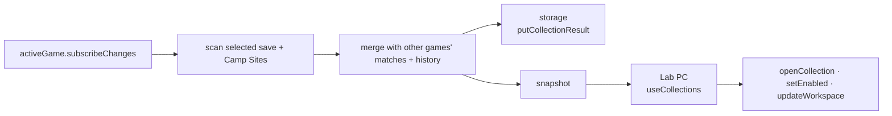

# Collections service

`collections` (a `CollectionsService`) owns the Lab PC's data: the enabled
collection definitions, their stored results, and the per-collection workspace
(selected entry, match, search/filter, mobile tab, scroll). It subscribes to
committed `activeGame` changes. Each scan reads only the selected committed save
plus the Camp Sites, replaces matches from those sources, and keeps matches and
ownership history from other games. Unreadable Camp positions are retained.
Results persist through the storage provider (`putCollectionResult`).

The PC reads and writes everything through the service with `useCollections`:
`openCollection` and `setEnabled` manage the visible tabs, recency, and overflow;
`updateWorkspace` saves session state; `refresh` and `reloadDefinitions` rescan
on demand; `resetHistory` clears one collection's stored result.

