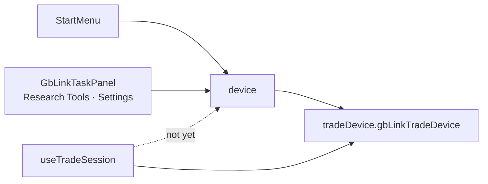

# Device service

`device` is the page-facing hardware facade. It exposes the GB-Link's support,
connection state, `connect`/`disconnect`, and cartridge operations (`readSave`,
`readRom`, `readBios`, `writeSave`) while the implementation stays in
`tradeDevice`'s `gbLinkTradeDevice`. Start uses it to read a cartridge save or
ROM into a game slot, and `GbLinkTaskPanel` uses it for Research Tools and Camp
cartridge tasks. Trades do not use the facade yet: `useTradeSession` calls
`tradeDevice` directly.

