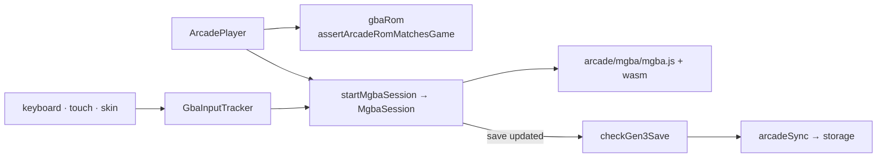

# Emulator service

The emulator service holds the Arcade's framework-free GBA pieces.
`mgbaRuntime` lazy-loads the pinned `@thenick775/mgba-wasm` build from
`arcade/mgba/` (inside the isolation service worker's scope, so its pthread
workers load) and runs one session per document: `startMgbaSession` boots a ROM
and save in memory, and the returned `MgbaSession` controls pause, reset,
buttons, speed, volume, and save reads. `gbaRom` reads the cartridge game code
and checks a ROM against the selected game. `gen3SaveSlots.checkGen3Save`
refuses snapshots taken mid-save, so only a complete, settled in-game save
reaches storage. `GbaInputTracker` merges keyboard and multiple pointers,
releasing a button only when every source has let go.

Save synchronization (`arcadeSync`), controls, and skins stay in
`pages/pokestorage/arcade/`; they call this service and the storage provider.

