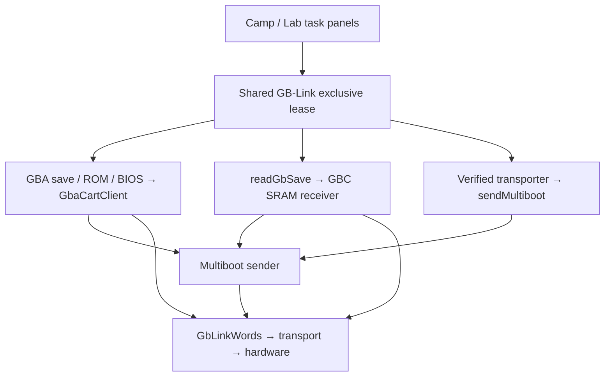

# Cartridge save-transfer architecture

GBA save, ROM, and BIOS operations use a shared GB-Link transport to multiboot
the vendored Cart Doctor dumper. `GbaCartClient` identifies cartridges and
moves data in checksummed sections through `GbLinkWords`. Callers can require
a matching game and must persist the original save before restore writes;
the BIOS path skips cartridge identification. Restore supports Gen 3, while
backups and ROM dumps read other GBA cartridges. The GB/GBC backup path boots
the GBC-mode payload, validates SRAM sections with bounded retries, rejects
ROM/restore headers, and restores adapter voltage during cleanup.

`sendMultiboot` shares the existing sender with the transporter service,
which verifies its pinned program before upload. These operations run under
exclusive device leases with abort/progress callbacks. Camp/Lab present them
through shared task panels and helpers, retaining the connection between
Research Tools tasks and releasing it on exit. Cancellation suppresses success
reporting and cleans up adapter mode; it cannot guarantee rollback of a partial
cartridge write.

