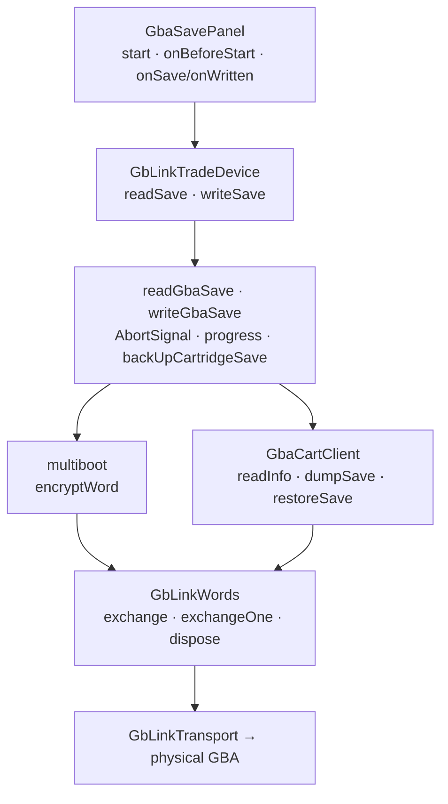

# Cartridge save-transfer architecture

`readGbaSave` and `writeGbaSave` use the shared GB-Link transport to multiboot the
vendored Cart Doctor dumper onto a GBA. The client identifies the cartridge and
moves saves in checksummed sections. Game-code and adapter validation keep
Cabin/cartridge versions aligned; the caller supplies the backup step that
persists the original cartridge save before overwriting it.

`GbaSavePanel` exposes progress and registers active transfers with the shared
navigation guard. Unmount aborts/disconnects; cancellation suppresses success
reporting but does not guarantee rollback of a partially written cartridge.
The service is Gen 3-only and uses WebUSB/Web Serial capability checks, a shared
transport, vendored dumper bytes, and their provenance/license records.

