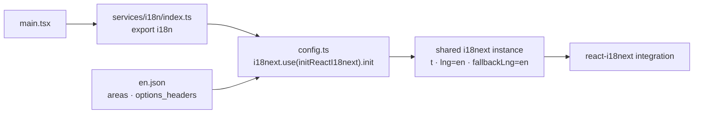

# i18n architecture

`main.tsx` imports the site-wide `services/i18n` entry point. Its `config.ts`
initializes the shared i18next instance through `initReactI18next`, registers
`en.json` in the translation namespace, and selects English as both language
and fallback. Escaping is disabled because React escapes text. `index.ts`
exports the same initialized `i18n` instance for future page/service consumers.

The English catalog and startup behavior are preserved. Screens still use
inline text; no page calls `useTranslation()` yet, and there is no runtime
language selection/detection. The catalog contains early area names and a news
heading. Translation adoption is tracked in the [site roadmap](../../../ROADMAP.md).

