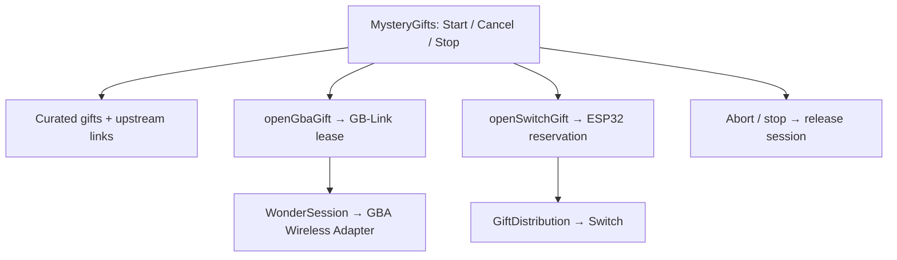

# Mystery Gift architecture

`openGbaGift` and `openSwitchGift` create groups that send the chosen Wonder
Card to joining consoles until stopped. Both expose `GiftLink`
(`setGift`, `decide`, `stop`) and callbacks through `GiftLinkHandlers`.
The GBA sender requires GB-Link firmware 2.2.7+, claims Wireless Adapter mode,
and runs the vendored WonderSession. The Switch sender requires ESP32 firmware
2.1.0+ and Switch keys, claims its bridge, and runs GiftDistribution.

`gifts.ts` defines six curated upstream IDs and links to the full catalogs.
Senders/card data load lazily and persist nothing. Abort signals cover connection
and startup; shutdown waits for startup/queued work, removes listeners/tickers,
and releases the device reservation. Repeated Stop calls share one promise.
The page cancels on unmount and suppresses late callbacks/returned sessions.

