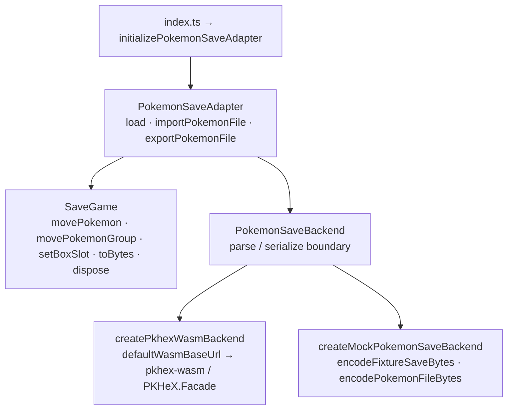

# Pokémon adapter architecture

`initializePokemonSaveAdapter` exposes typed save/Pokémon operations over a
backend. The real backend boots the vendored PKHeX WASM runtime once; the mock
backend reads deterministic fixtures. React handles `SaveGame`/`PokemonNode`
projections rather than raw WASM. Gen 3 is the enabled save workflow, and party
writes are not exposed by the current backend.

Each caller owns and disposes its loaded saves; shared storage requests only
share requests and return cloned byte results. Pokémon export uses PKHeX-produced bytes. The ignored
local npm package is built by `setup:pkhex-wasm` before root installation;
real-save tests skip without local fixtures. The tracked production trade
placeholder lives separately in `src/assets/trade/`.

