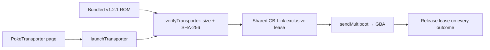

# Poké Transporter GB launch architecture

`launchTransporter` decodes the bundled official v1.2.1 ROM and calls
`verifyTransporter` to check its pinned 124,024-byte size and SHA-256 before
acquiring the shared GB-Link's exclusive lease. It then calls `sendMultiboot`
with the lease's transport, abort signal, and progress callback, releasing the
lease in `finally` on success, cancellation, or failure. Asset provenance and
licensing live beside the bundled ROM.

The page handles optional GB/GBC and GBA save backups through separate
cartridge services before launch. This service only verifies and sends the
program; the consoles perform the Pokémon transfer after the cable handoff.
Successful upload does not report completion of that console transfer.

