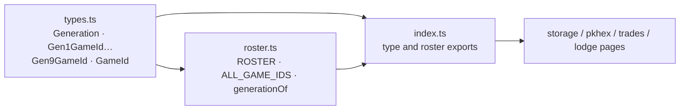

# Game roster architecture

`saveLibrary` contains stable game/generation identifiers and display-order
rosters through Gen 9. A lowercase game id such as `emerald` keys its save/ROM
slot elsewhere. Only Gen 3 currently has working save screens; inclusion in
the roster does not imply parser or transfer support.

This module performs no I/O and stores no bytes, snapshots, or audit log.
`services/storage` owns persistence. Renaming an id changes the storage key and
can orphan existing player data.

