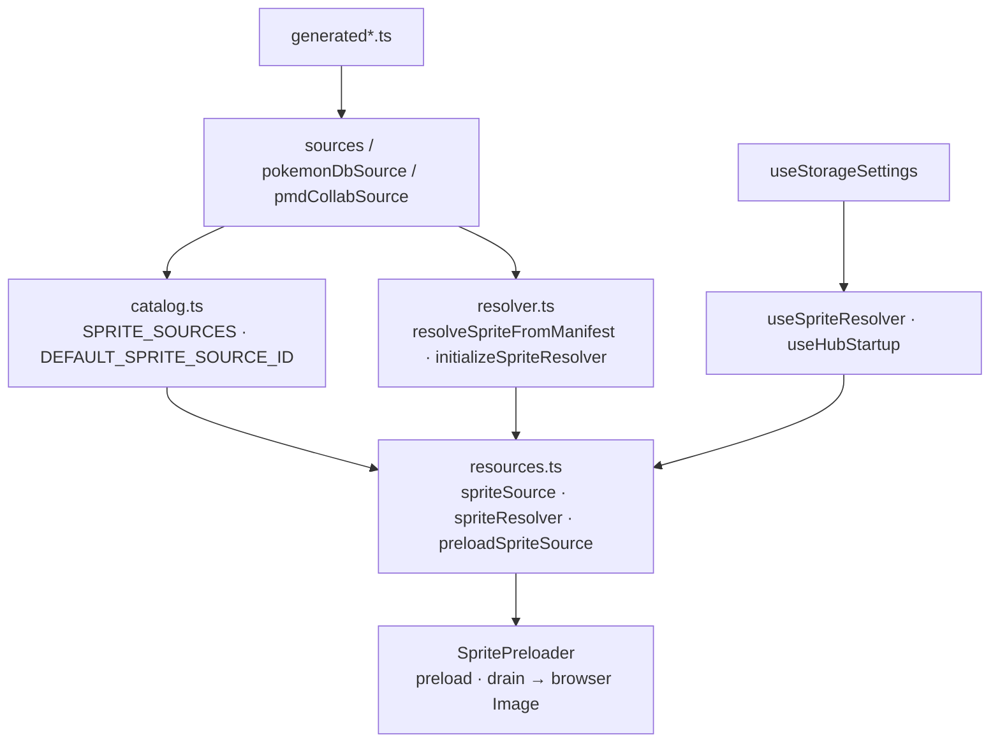

# Sprite architecture

Normalized Pokémon requests resolve to a verified asset path or an explicit
fallback. Generated manifests describe PokeAPI, Shuffle, PokémonDB, and PMD
SpriteCollab coverage; resolution does not parse saves or perform I/O.
`catalog.ts` owns selectable sources and page consumers import it directly.

`resources.ts` caches one resolver per source and preloads selected base images
through a six-request queue. Paths/successes are deduplicated; changing source
replaces queued work while active requests finish, and failures do not stall
the queue. Saved provider settings update React consumers; the persistent hub
startup hook requests preloading. Images still come from third-party hosts.

