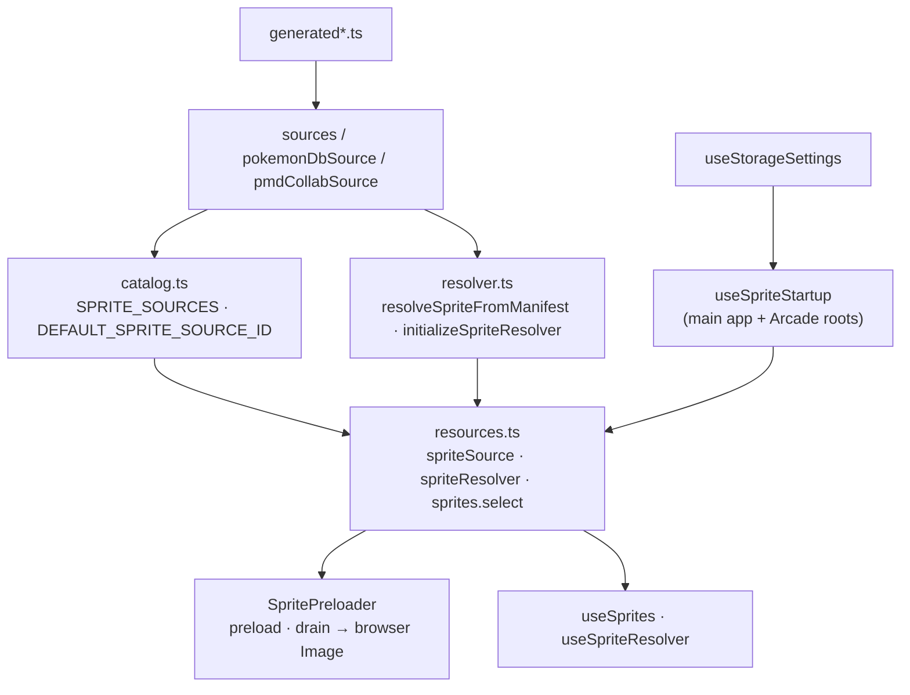

# Sprite architecture

Normalized Pokémon requests resolve to a verified asset path or an explicit
fallback. Generated manifests describe PokeAPI, Shuffle, PokémonDB, and PMD
SpriteCollab coverage; resolution does not parse saves or perform I/O.
`catalog.ts` owns selectable sources and page consumers import it directly.

`resources.ts` caches one resolver per source and owns the `sprites` service
(subscribe / getSnapshot / select), mirroring the guide service. Every app
root (the main app and the separate Arcade document) calls `useSpriteStartup`,
which selects the saved source as soon as settings load and again when it
changes. Selecting starts preloading every asset of that source, base forms
first, through a six-request queue. Paths/successes are deduplicated; changing
source replaces queued work while active requests finish, and failures do not
stall the queue. Views read the resolver with `useSprites` / `useSpriteResolver`.

Images still come from third-party hosts. The Arcade is cross-origin isolated
(`COEP: require-corp`), so it can only show hosts that send CORP or CORS
headers; sources declare this as `isolationSafe`, and an unsafe selection
(PokémonDB) falls back to the default source there.

