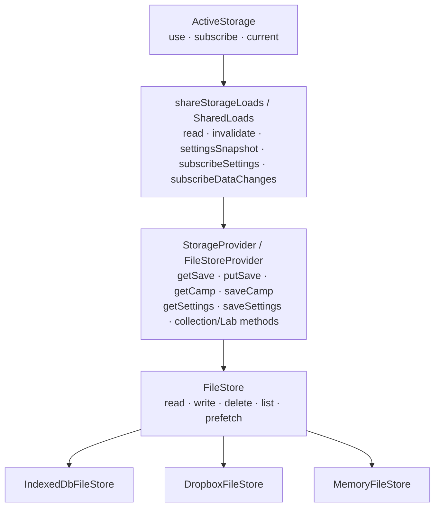

# Storage architecture

`StorageProvider` persists opaque saves, ROMs, Camp Sites, settings, collection
results, and Lab data. The active `storage` facade selects a provider and wraps
it with `shareStorageLoads`; both local IndexedDB and Dropbox use the same
`FileStoreProvider` layout. Saves use calendar-day current/previous files,
hardware backups remain separate, and Camp positions remain stable.

Overlapping save/Camp/settings/prefetch requests share I/O but return cloned
results. Each successful save or Camp write or removal notifies
`subscribeDataChanges` listeners, which keep Lab collections current. Completed save/Camp reads are not cached by this wrapper; settings
retain an observable snapshot per provider. Successful preference writes
publish changes, failures retain prior settings, and versions reject stale
responses. Writes detach affected pending reads; callers still discard obsolete
results. This is neither multi-device conflict resolution nor a cross-file
transaction; unreachable providers do not redirect writes to local storage.

