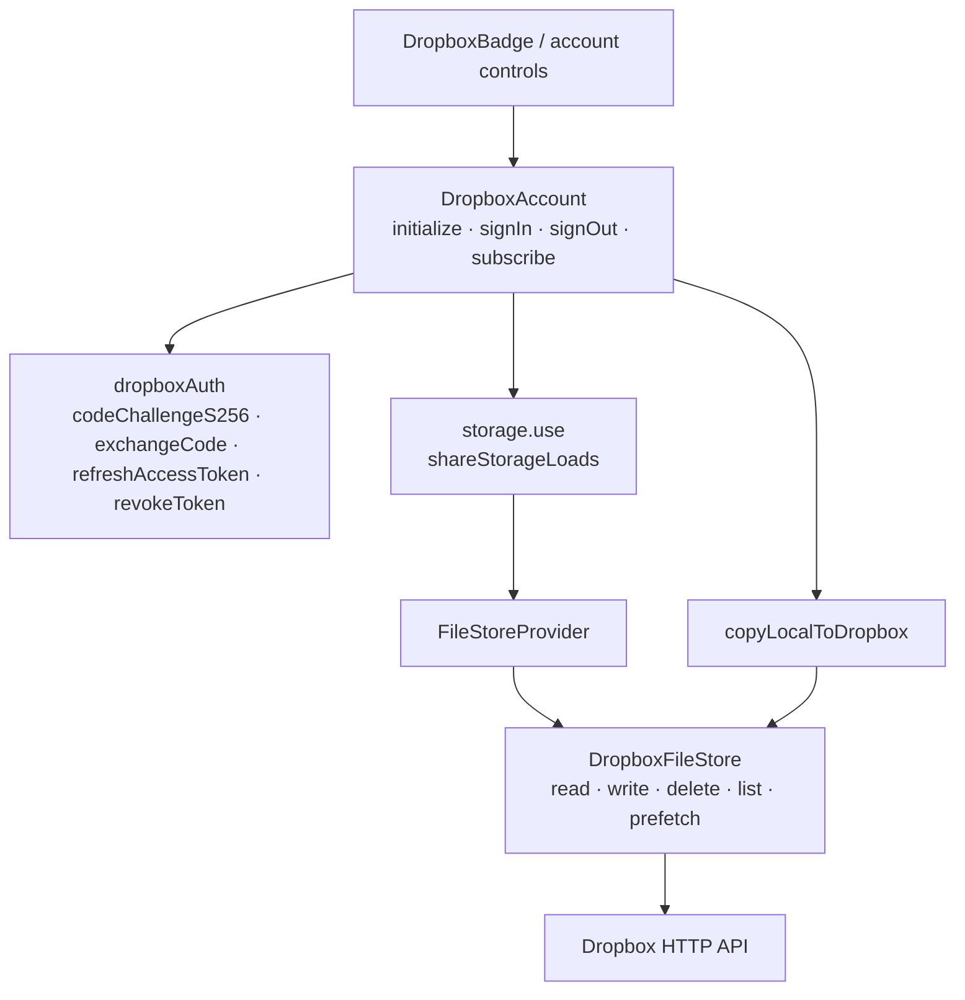

# Dropbox architecture

`DropboxAccount` performs browser OAuth PKCE, finishes redirects/restores a
session once, refreshes tokens, and revokes/forgets them on sign-out. Connecting
copies browser data Dropbox lacks without overwriting existing remote files;
disconnecting returns to the retained browser copy. It selects a
`FileStoreProvider` over `DropboxFileStore`, wrapped by active storage's shared
loading/settings support.

The file store handles Dropbox API paging, retries, remote caching, and
prefetch. Account error state makes UI saves read-only without silently changing
provider. `VITE_DROPBOX_APP_KEY` is required at build time; without it controls
are hidden. UI badges and settings actions consult the root navigation guard;
the account service itself is framework-free and displays no confirmations.

