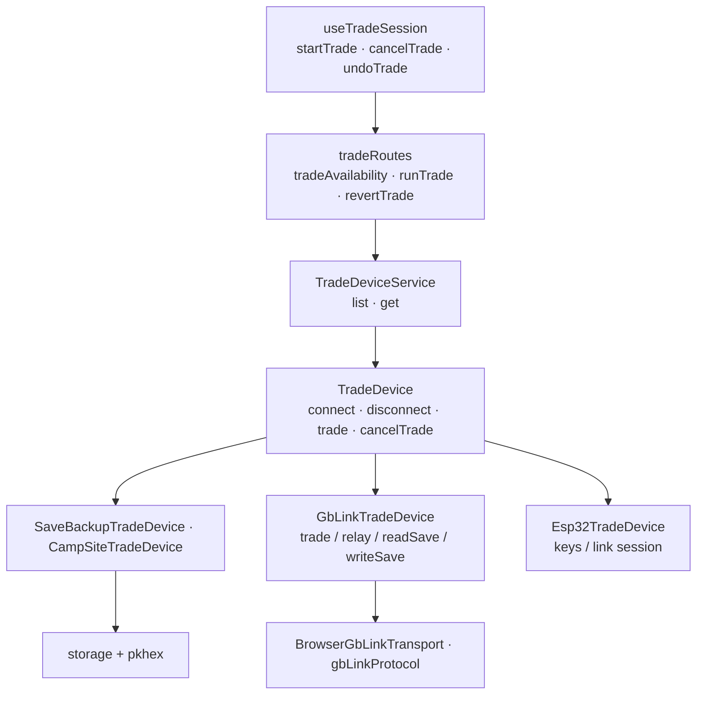

# Trade-device architecture

`runTrade` pairs a Gen 3 save backup, Camp Site, GB-Link GBA, or ESP32 Switch
source through one device interface. Stored writes preserve selected positions
and validate expected source bytes. `revertTrade` restores recorded PkCamp
writes, never physical-console state. GBA ↔ Switch is a live relay with no
PkCamp persistence; GB-Link stored exchanges use the disclosed production
placeholder when firmware cannot return the received Pokémon.

Camp/Lab share `useTradeSession`, whose active guard protects Back/Dropbox and
whose unmount cleanup cancels/disconnects. The placeholder is tracked at
`src/assets/trade/ribbondol.pk3`; personal fixtures are not a production
dependency. GB-Link firmware checks, permissions, transport errors, and events
remain behind device adapters and vendored client code.

