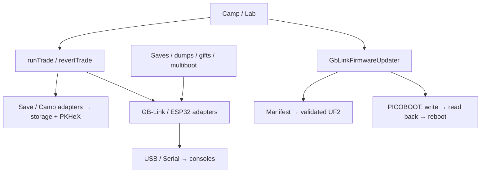

# Trade-device architecture

`runTrade` pairs Gen 3 save backups, Camp Sites, GB-Link GBA, or ESP32 Switch
sources through device adapters. Stored writes validate source bytes and
preserve positions; `revertTrade` reverses recorded PkCamp writes only.
GBA ↔ Switch is a live relay. GB-Link stored exchanges disclose the tracked
production placeholder when firmware cannot return received Pokémon. Shared
connections and exclusive operations also support saves, dumps, gifts, and
multiboot; cancellation rejects late selections, and repeated disconnect calls
wait for the same cleanup. Closing a USB transport closes the device before
waiting for its pending reads; a link that drops on its own reports
`onDetach`, and the device releases it so the next `connect()` succeeds.
`open()` reuses an already permitted GB-Link before showing the chooser.

Camp/Lab share guarded trading and hardware settings. `GbLinkFirmwareUpdater`
checks the upstream manifest, validates a downloaded UF2, then writes and reads
it back through the vendored PICOBOOT client before reboot/version verification.
Leaving aborts preparation, while a started flash finishes verification/reboot.
Its bootloader handle is separate from the normal GB-Link transport. Device
adapters own permissions, firmware requirements, transport errors, and leases;
page components own presentation and navigation.

